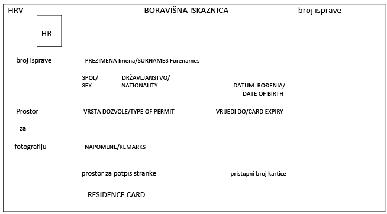
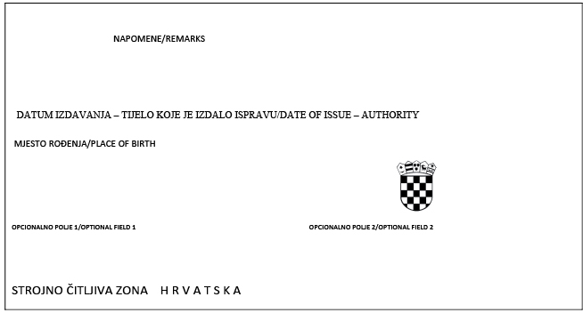
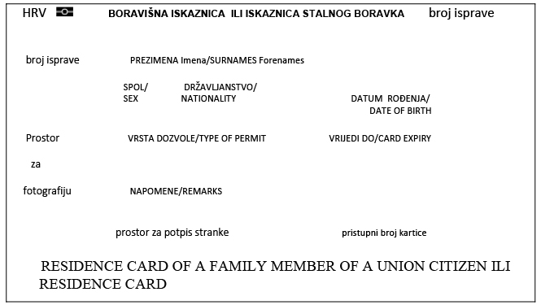
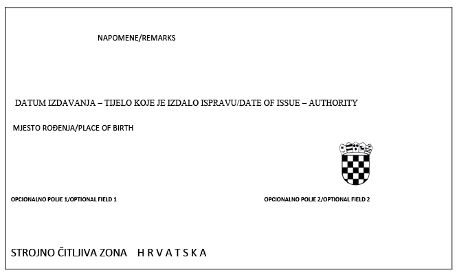

# Amendment NN 86/21

- Jurisdiction: croatia
- Source ID: `hr-eea-reg-amend-86-21`
- Source type: `amending_regulation`
- Official source URL: https://narodne-novine.nn.hr/clanci/sluzbeni/2021_07_86_1596.html
- Resolved URL: https://narodne-novine.nn.hr/clanci/sluzbeni/2021_07_86_1596.html
- Retrieved: 2026-10-19T02:21:25+00:00
- Media type: `text/html`
- Publisher/version evidence: Official amendment record opened from MUP index
- Extraction: `.sl-content .doc` (official text fragment; page shell excluded)
- Exact response SHA-256: `45191d745c1e061e1e8bbd7da794928340404092761b7bccc260d203792e28e0`

> **Accepted source record.** This individual official source passed the local-artifact checks recorded in `references/source-acceptance.json`. Acceptance does not establish legal-topic coverage, legal equivalence, or country completion.

## Retained representation scope

The official Gazette’s Article 11 makes the Form 4b and Form 11b card specimens integral parts of this regulation. Their four original JPEG images are retained unchanged below. Form 2b is a separate application form, not a card specimen.

### Form 4b — EEA national residence-card specimen

### Form 11b — non-EEA family-member residence-card specimen

The four images were visually checked at their source dimensions on 25 October 2026 and match the image links embedded in the [official NN 86/21 record](https://narodne-novine.nn.hr/clanci/sluzbeni/2021_07_86_1596.html). They are blank legal specimens; they do not show the security features or variable data of a currently issued card. The official Croatian text of Regulation (EU) 2025/1208 Article 7(2) prescribes the same standardized Article 10/20 code wording found in NN 86/21 Article 27a(5). Whether MUP’s currently issued Form 11b carries that code in data field [10], and whether the actual card meets Article 7, remain unverified. Article 8’s phase-out rule applies only to non-EU family-member cards: Article 8(2)(b) allows certain cards that fail Article 7 but meet the specified ICAO and Annex conditions to remain valid until expiry or 3 August 2031; cards without minimum ICAO security or a functional MRZ are not valid. The blank Form 11b image establishes none of those conditions. Article 6 separately sets minimum information for documents issued to Union citizens; its personal scope for every EEA nationality covered by Form 4b has not been determined in this review. MUP’s current legislation index lists the EEA rule chain through NN 155/22, and its forms index lists Forms 1b, 2b, 3b and 6b but no current card specimen. No conclusion about cards actually issued by MUP is made. See the official [Croatian text of Regulation (EU) 2025/1208](https://eur-lex.europa.eu/eli/reg/2025/1208/oj/hrv). See `references/attachment-review.json` and `references/source-dependencies.json`.

## Official text-only capture

MINISTARSTVO UNUTARNJIH POSLOVA

1596

Na temelju članka 34. stavka 3. Zakona o državljanima država članica Europskog gospodarskog prostora i članovima njihovih obitelji (»Narodne novine«, br. 66/19, 53/20 i 144/20) te članka 38. stavka 3. Zakona o sustavu državne uprave (»Narodne novine« br. 66/19) ministar unutarnjih poslova, uz prethodnu suglasnost ministra vanjskih i europskih poslova, donosi

PRAVILNIK

O IZMJENAMA I DOPUNAMA PRAVILNIKA O ULASKU I BORAVKU U REPUBLICI HRVATSKOJ DRŽAVLJANA DRŽAVA ČLANICA EUROPSKOG GOSPODARSKOG PROSTORA I ČLANOVA NJIHOVIH OBITELJI

Članak 1.

U Pravilniku o ulasku i boravku u Republici Hrvatskoj državljana država članica Europskog gospodarskog prostora i članova njihovih obitelji (»Narodne novine«, br. 107/20 i 148/20) u članku 1. iza stavka 9. dodaju se novi stavci 10., 11. i 12. koji glase:

»(10) Ovim Pravilnikom osigurava se provedba Uredbe (EU) 2019/1157 Europskog parlamenta i Vijeća od 20. lipnja 2019. o jačanju sigurnosti osobnih iskaznica građana Unije i boravišnih isprava koje se izdaju građanima Unije i članovima njihovih obitelji koji ostvaruju pravo na slobodno kretanje (tekst značajan za EGP) (SL L 188, 12. 7. 2019.).

(11) Ministarstvo je kontaktna točka za provedbu Uredbe iz stavka 10. ovoga članka.

(12) Ministarstvo će jednom godišnje Europskoj komisiji dostaviti podatke o tijelu odgovornom za tiskanje boravišnih iskaznica.«.

Dosadašnji stavak 10. postaje stavak 13.

Članak 2.

U članku 11. stavak 5. mijenja se i glasi:

»(5) Potvrda o prijavi privremenog boravka iz stavka 4. ovoga članka sadrži: naziv nadležnog tijela, urudžbeni broj, datum izdavanja potvrde, poziv na članak 8. stavak 2. Direktive 2004/38/EZ, naziv potvrde na hrvatskom i engleskom jeziku, ime i prezime državljanina države članice EGP-a, OIB, datum, mjesto i državu rođenja, državljanstvo, adresu stanovanja, datum prijave privremenog boravka, potpis službene osobe i pečat, a ispisuje se na obrascu koji u desnom gornjem uglu sadrži dvoslovnu oznaku Republike Hrvatske otisnutu u negativu u plavom pravokutniku i okruženu s dvanaest žutih zvjezdica.«.

Članak 3.

Članak 20. mijenja se i glasi:

»(1) Za državljanina države članice EGP-a i člana njegove obitelji koji imaju privremeni boravak nadležna policijska uprava odnosno policijska postaja u posebnim slučajevima, ako postoji opravdana sumnja, zatražit će provjere radi utvrđivanja ispunjenja uvjeta iz članka 22. odnosno 24. Zakona.

(2) Rješenje o prestanku privremenog boravka na temelju članka 22. stavka 1. točke 2. Zakona neće se donijeti ako državljanin države članice EGP-a ispunjava uvjete za neku od svrha privremenog boravka propisanih člankom 13. stavkom 1. Zakona, što dokazuje dokumentacijom propisanom člancima 13., 14., 15. ili 16. ovoga Pravilnika.

(3) U slučaju iz stavka 2. ovoga članka državljaninu države članice EGP-a neće se izdati nova potvrda prijave privremenog boravka ni nova boravišna iskaznica, već će se promjena svrhe samo evidentirati u Informacijski sustav Ministarstva.«.

Članak 4.

U članku 27. stavak 1. mijenja se i glasi:

»(1) Državljaninu države članice EGP-a izdaje se boravišna iskaznica na Obrascu 4b.«.

U stavku 2. na kraju rečenice umjesto točke stavlja se zarez te se dodaju riječi: »te sadrži dvoslovnu oznaku Republike Hrvatske otisnutu u negativu u plavom pravokutniku i okruženu s dvanaest žutih zvjezdica, a ne sadrži elektronički nosač podataka (RFID čip) ni međunarodni simbol za elektroničku ispravu.«.

Stavak 5. mijenja se i glasi:

»(5) Državljaninu države članice EGP-a:

– koji ima privremeni boravak, u Obrascu 4b na prednjoj strani u rubrici: »vrsta dozvole« upisuju se riječi: »EGP- čl. 8. st. 2. Direktive 2004/38/EZ«, a u rubrici: »napomene« upisuju se riječi: »privremeni boravak«

– koji ima stalni boravak, u Obrascu 4b na prednjoj strani u rubrici: »vrsta dozvole« upisuju se riječi: »EGP- čl. 19. Direktive 2004/38/EZ«, a u rubrici: »napomene« upisuju se riječi: »stalni boravak«.

Stavci 7., 8., 9. i 10. brišu se.

Članak 5.

Iza članka 27. dodaju se članci 27.a i 27.b koji glase:

»Članak 27.a

(1) Članu obitelji državljanina države članice EGP-a koji nije državljanin države članice EGP-a izdaje se boravišna iskaznica na Obrascu 11b.

(2) Obrazac 11b pravokutnog je oblika, veličine 85,6 × 53,98 mm, izrađen je od polikarbonatnog materijala, serijski broj dokumenta sadrži sedam znamenaka, a datumi se upisuju na način, da se brojevi odvajaju razmacima bez točke.

(3) Obrazac 11b sadrži elektronički nosač podataka (RFID čip) na koji se pohranjuju podaci: ime i prezime, državljanstvo, datum rođenja, spol, oznaka za vrstu isprave, oznaka države, broj isprave, osobni identifikacijski broj, datum izdavanja i datum isteka valjanosti, tijelo koje je izdalo ispravu, fotografija i otisci prstiju, pristupni broj kartice.

(4) U Obrazac 11b na drugoj stranici u rubrici »napomene« upisuju se podaci o PU/PP koja je izdala iskaznicu, adresi stanovanja i OIB, a u prostoru za strojno čitanje kao oznaka za vrstu isprave upisuje se podatak: »AB«, a kao podatak o spolu upisuje se oznaka »Ž/F« za ženski spol, te oznaka »M/M« za muški spol.

(5) Članu obitelji državljanina države članice EGP-a koji nije državljanin države članice EGP-a koji ima privremeni boravak, u Obrazac 11b na prvoj strani u gornjem dijelu upisat će se naziv: »BORAVIŠNA ISKAZNICA«, ako ima stalni boravak upisat će se naziv: »ISKAZNICA STALNOG BORAVKA«, u donjem dijelu upisat će se riječi: »RESIDENCE CARD OF A FAMILY MEMBER OF A UNION CITIZEN«, te se upisuje:

– ako ima privremeni boravak, na prednjoj strani u rubrici: »vrsta dozvole« riječi: »Član obitelji EU čl. 10. DIR 2004/38/EZ«, a u rubrici: »napomene« riječi: »privremeni boravak«

– ako ima stalni boravak, na prednjoj strani u rubrici: »vrsta dozvole« riječi: »Član obitelji EU čl. 20. DIR 2004/38/EZ«, a u rubrici: »napomene« riječi: »stalni boravak«.

(6) Članu obitelji iz članka 19. stavka 4. ovoga Pravilnika koji ima privremeni boravak, u Obrazac 11b na prvoj strani u gornjem dijelu upisat će se naziv: »BORAVIŠNA ISKAZNICA«, ako ima stalni boravak upisat će se naziv: »ISKAZNICA STALNOG BORAVKA«, u donjem dijelu upisat će se riječi: »RESIDENCE CARD OF A FAMILY MEMBER OF A UNION CITIZEN«, te se upisuje:

– ako ima privremeni boravak na prednjoj strani u rubrici: »vrsta dozvole« riječi: »Član obitelji EU čl. 10. DIR 2004/38/EZ«, a u rubrici: »napomene« riječi: »privremeni boravak-član obitelji drž. RH«

– ako ima stalni boravak na prednjoj strani u rubrici: »vrsta dozvole« riječi: »Član obitelji EU čl. 20. DIR 2004/38/EZ«, a u rubrici: »napomene« riječi: »stalni boravak«.

(7) Životnom partneru iz članka 18. stavka 2. ovoga Pravilnika, u Obrazac 11b na prvoj strani u gornjem dijelu upisat će se naziv: »BORAVIŠNA ISKAZNICA«, u donjem dijelu upisat će se riječi »RESIDENCE CARD«, te se upisuje:

– ako ima privremeni boravak, na prednjoj strani u rubrici: »vrsta dozvole« riječi: »privremeni boravak«, a u rubrici: »napomene« riječi: »životni partner drž. EGP-a«

– ako ima stalni boravak, na prednjoj strani u rubrici »vrsta dozvole« riječi: »stalni boravak«.

(8) Životnom partneru iz članka 19. stavka 5. ovoga Pravilnika, u Obrazac 11b na prvoj strani u gornjem dijelu upisat će se naziv: »BORAVIŠNA ISKAZNICA«, u donjem dijelu upisat će se riječi »RESIDENCE CARD«, te se upisuje:

– ako ima privremeni boravak, na prednjoj strani u rubrici: »vrsta dozvole« riječi: »privremeni boravak«, a u rubrici; »napomene« riječi: »životni partner drž. RH«

– ako ima stalni boravak, na prednjoj strani u rubrici: »vrsta dozvole« riječi: »stalni boravak«.

Članak 27.b

(1) Zahtjev za izdavanje boravišne iskaznice podnosi se osobno.

(2) Zahtjev za izdavanje boravišne iskaznice za dijete podnosi zakonski zastupnik.

(3) Dijete do navršenih 12 godina ne mora biti nazočno prilikom podnošenja zahtjeva za izdavanje boravišne iskaznice.«.

Članak 6.

U članku 28. stavku 1. riječi: »Obrascu 4b« zamjenjuju se riječima: »Obrascu 4b ili Obrascu 11b«.

Članak 7.

U članku 30. stavku 1. točki 8. na kraju rečenice briše se točka, te se dodaje točka 9. koja glasi:

»9. uzetim otiscima prstiju i fotografiji članova obitelji državljana država članica EGP-a koji nisu državljani država članica EGP-a u postupku izdavanja boravišne iskaznice.«.

Stavak 6. mijenja se i glasi:

»(6) Podaci u zbirkama podataka iz stavka 1. točke 5., 6., 7., 8. i 9. ovoga članka koji se vode na Informacijskom sustavu Ministarstva čuvaju se trajno, a tijelo odgovorno za tiskanje boravišnih iskaznica iz članka 1. stavka 12. ovoga Pravilnika čuva podatke iz stavka 1. točke 9. ovoga članka najduže 90 dana od datuma izdavanja boravišne iskaznice.«.

Članak 8.

U članku 41. iza stavka 4. dodaje se stavak 5. koji glasi:

»(5) Zbirka podataka o uzetim otiscima prstiju i fotografiji članova obitelji državljana država članica EGP-a koji nisu državljani država članica EGP-a u postupku izdavanja boravišne iskaznice sadrži:

1. opće podatke iz članka 31. ovoga Pravilnika

2. fotografiju

3. otiske prstiju.«.

Članak 9.

U članku 42.g u stavku 1. točki 1. broj: »79,50« zamjenjuje se brojem: »100,00«.

Stavak 3. briše se.

Prijelazne i završne odredbe

Članak 10.

Članu obitelji državljanina države članice EGP-a koji nije državljanin države članice EGP-a boravišne iskaznice izdane na temelju odredaba Pravilnika o ulasku i boravku u Republici Hrvatskoj državljana država članica Europskog gospodarskog prostora i članova njihovih obitelji (»Narodne novine«, br. 107/20 i 148/20) prestaju važiti istekom njihova roka važenja, a najkasnije 3. kolovoza 2026. godine, ako je rok njihova važenja duži.

Članak 11.

Obrazac boravišne iskaznice (Obrazac 4b) koji je tiskan uz Pravilnik o ulasku i boravku u Republici Hrvatskoj državljana država članica Europskog gospodarskog prostora i članova njihovih obitelji (»Narodne novine« br. 107/20) i njegov je sastavni dio zamjenjuje se novim Obrascem 4b koji je tiskan uz ovaj Pravilnik i njegov je sastavni dio.

Obrazac boravišne iskaznice članu obitelji državljanina države članice EGP-a koji nije državljanin države članice EGP-a (Obrazac 11b) tiskan je uz ovaj Pravilnik i njegov je sastavni dio.

Članak 12.

Ovaj Pravilnik objavit će se u »Narodnim novinama«, a stupa na snagu 2. kolovoza 2021. godine.

Klasa: 011-02/21-01/192

Urbroj: 511-01-152-21-18

Zagreb, 26. srpnja 2021.

Ministar
dr. sc. Davor Božinović, v. r.

Obrazac 4b

Obrazac 11b
